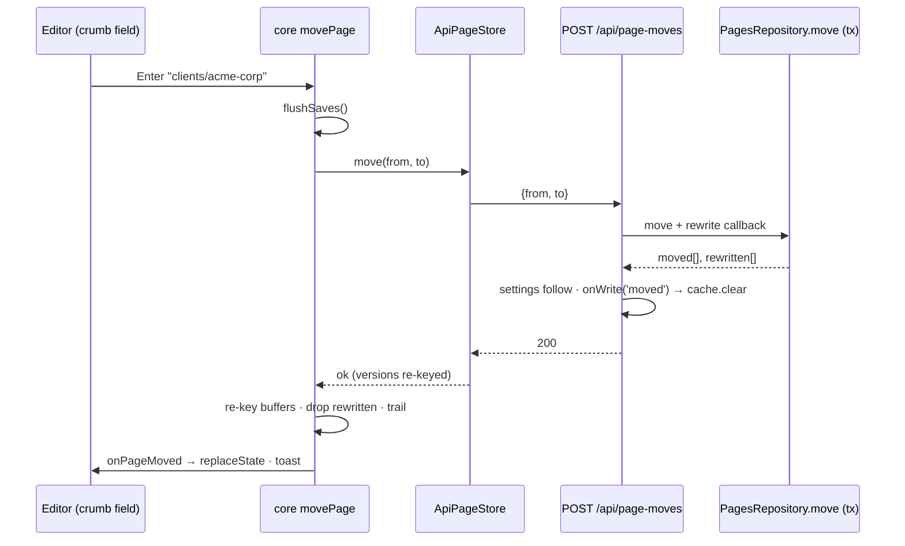

# Let editors change a page's slug after creation

Issue: #15

## Goal

An editor can **move** an existing page to a new slug from the editing surface, by clicking the active breadcrumb crumb or choosing "Move page…" in the header menu, and typing the new address inline. The move takes the **whole subtree** with it (`alpha` → `gamma` also moves `alpha/*` → `gamma/*`). In the same all-or-nothing operation, every internal link in the wiki that pointed at a moved page is **rewritten** to its new address, and the instance settings that named a moved page (home, nav, 404, 403) follow it. Every old slug becomes an **alias** that redirects (301) to the page's current address, so bookmarks, external links, stale editor tabs and in-flight autosaves keep working and never recreate a page at the old slug.

## Non-goals

- **Reusing an old slug** through the UI: there is no "create a new page here instead" action and no alias list/management screen. The editor follows an alias when it navigates to it. An alias is dropped only when a page is moved onto that slug, or when its page is deleted (cascade). Future toolbar/popup tooling owns this.
- "Rename the URL to match the H1" suggestions.
- The CodeMirror 6 spike (`?cm6=1`, `src/core/cm6/`, `src/client/cm6-spike.ts`). It keeps the shared breadcrumb unchanged because the new option is opt-in.
- `move` on the core `MemoryPageStore`. Without a store that supports `move`, the rename affordance is hidden.
- Rewriting links outside page content: the admin-authored `headerHtml`/`footerHtml` bands and themes. The old slugs' aliases keep those links working.
- Links with fragments or queries (`[t](/x#h)`). They do not address pages today (the fold turns them into `x-h`).
- Image sources, media links, external URLs.
- Moving several unrelated pages at once, merging pages, or undoing a move with Ctrl+Z. Undo = move it back. Moving back onto the old slug reclaims the alias.
- Reader-side href canonicalization (writing the new slug into hrefs of links that still point at an alias). Rewriting makes it unnecessary inside the wiki.

## Context

- **Slug policy:** `src/shared/slug.ts`.
  - `validateSlug`, `slugify`, `navTargetToSlug === wikiTargetToSlug`, `slugDisplayName` (last segment only).
  - `wikiLinkBase(pageSlug, homeSlug)` + `wikiLinkAddress(target, base)` (#12) decide where relative `[[x]]` resolves (under the page's own slug; root on the configured home page).
  - DB `CHECK` regex in `migrations/001_init.sql`. AGENTS.md: slug.ts, the CHECK and routes change together.
- **Schema:** `pages(id BIGSERIAL PK, slug UNIQUE CHECK, title, content, version, …)`. `id` is stable today but unused by the app. Migrations `001`–`006`; the next is `007`.
- **Repository:** `src/server/db/repository.ts` (`PagesRepository`), `pages-pg.ts`, `pages-memory.ts`.
  - `existing(slugs)` backs link styling (reader + `/api/pages-exist`).
  - The pattern for pg transactions with an advisory lock is `users-pg.ts:59-80` (`pool.connect()`, `BEGIN`, `pg_advisory_xact_lock`).
- **Pages API:** `src/server/routes/pages-api.ts`.
  - The `/api/pages/*` wildcard claims every suffix. `/api/pages-exist` lives outside it for that reason, and the move endpoint must too.
  - Write guard: `requireSameOrigin` + `requireRole('editor','admin')`.
  - Titles come from `extractTitle` (`render/title.ts`, first H1–H3).
  - `onWrite(slug, PageWriteChange)` feeds `app.ts` `invalidate`, which calls `cache.clear()` whenever `change !== 'updated'`.
- **HTML routes:** `src/server/routes/pages-html.ts`.
  - The catch-all `/*` → `renderArticle(reply, req, slug, home)`.
  - When the page is missing: editors get a seeded editor shell (`page: null`); readers get the 404 document.
  - `/` renders `renderArticle(homeSlug, true)`.
- **Settings:** `src/server/settings.ts`.
  - `SettingsService.update(patch, by)` covers `homeSlug`, `navSlug`, `notFoundSlug`, `forbiddenSlug` (memoized in process; revision bump).
  - It is reachable from `app.ts` as `settingsService`. The pages API currently gets only `getSettings`.
- **Engine:** `src/core/document.ts` `buildDocument`.
  - Block pass; verbatim (fence) lines become one text token.
  - Line token raws concatenate byte-exact to the source line (fidelity contract).
- **Engine (cont.):** `src/core/static-renderer.ts`.
  - Container plugins (headings, inline emphasis, list items, table cells) render nested text via `context.renderInline(group)`.
  - `link-slugs.ts` already "rides the real render" through a recording context. The rewriter follows the same idea.
- **Link plugins:**
  - `src/core/plugins/wikiLink.ts` (`/\[\[([^\]]+)\]\]/`, `parseWikiLink` splits `|label`).
  - `src/core/plugins/link.ts` (`/\[([^\]]+)\]\(([^)]+)\)/`, internal targets via `classifyLinkTarget`).
- **Editor core:**
  - `editor-navigation.ts` (`navigateToPage` folds → loads/seeds → `applyTrailNavigation` → `loadPage`).
  - `page-buffers.ts` (`Map<slug,string>` + per-page history).
  - `editor-lifecycle.ts` (a single debounce timer; the page is captured at **schedule** time, `saveNow(page)`).
  - `editor-render.ts` `renderBreadcrumb` → `breadcrumb.ts` (the active crumb has **no** handler today), `editor-state.ts` trail.
  - `types.ts`: `PageStore {load, save}`, `EditorInstance`, `EditorOptions`.
- **Client:** `src/client/api-page-store.ts`.
  - Versions map keyed by slug.
  - **A PUT that gets 404 recreates the page through POST**: the hazard aliases must defuse.
  - `main.ts` `onTrailChange` → `pushState` when the page changes; `chrome.ts` `mountHeaderActions` builds the header menu; `link-existence.ts`.
- **Tests:** Vitest `dom` (core/client) and `node` (server/shared).
  - Relevant suites: `pages-api`, `pages-html`, `pages-memory`, `pages-pg.integration` (`WN_TEST_PG_URL`), `api-page-store`, `editor-navigation`, `editor-render`, `page-buffers`, `content-text` (corpus property), `link-slugs`, `node-smoke` (DOM-free guard).

## Decisions

| # | Decision | Alternative considered | Reason |
| - | -------- | ---------------------- | ------ |
| 1 | **Inbound links are rewritten** in the same operation as the move. | Alias-only (no content changes). | User decision: references must be renamed deeply. |
| 2 | The **whole subtree always moves**; there is no checkbox. References to children are rewritten too. | Optional or never. | User decision. Also required by #12: relative `[[beta]]` on `alpha` means `alpha/beta`, so leaving children behind would silently retarget links. |
| 3 | **Every old slug becomes an alias** (`page_aliases.slug → pages.id`) answered with a 301 to the current address. | No redirects. | User decision. Bookmarks and external links keep working, and stale tabs or in-flight autosaves get a "moved" answer instead of 404 → recreate. Aliases point at the **page id**, so moving A→B→C never builds chains, and an older alias follows the page automatically. |
| 4 | Page slugs and alias slugs are **disjoint**. Moving onto an alias slug deletes that alias. Creating a page at an alias slug is refused (`409 {movedTo}`). Deleting a page cascades its aliases. | Let a new page shadow an alias (WordPress-style). | One owner per URL and no shadowing ambiguity (WordPress #35031). Reclaiming through the UI is out of scope (Non-goals). Enforced in the repository, not by a cross-table DB constraint. |
| 5 | **Rewritten link style matches the original.** A slug-cased target (`[[projects/acme]]`) is written in slug form (`[[clients/acme-corp]]`). Otherwise each segment is humanized (`[[Projects/Acme]]` → `[[Clients/Acme Corp]]`), checked to round-trip through `slugify` (else slug form). An explicit `|label` is kept byte-exact; implicit display text follows the new name. | Keep the visible text via `|label`; always slug form. | User decision (Obsidian-like). |
| 6 | **Relative stays relative when it still can.** A relative wiki link stays relative if its new target is still under the linking page's (new) base; otherwise it becomes root-absolute `/…`. An absolute original stays absolute. A link is rewritten **only** when it resolved to a moved page **and** its text no longer resolves to the page's new slug. So relative links inside the moved subtree, and missing relative children, are left untouched. Markdown links keep root semantics and their leading-`/` choice. | Always rewrite to absolute. | Minimal diffs. The subtree's own relative links already follow the move. |
| 7 | Rewriting rides the ONE engine. A new optional plugin hook `ContentPlugin.rewriteLink?(token, ctx): string \| null` is implemented by `wikiLink.ts` and `link.ts` only. A generic DOM-free walker `src/core/link-rewrite.ts` reuses `buildDocument` (fences/verbatim untouched) and recurses into container plugins by recording their `renderInline(text)` calls, then splices rewritten inner text back into the token raw. When a splice can't be located, the walker leaves the token unchanged and never corrupts it. | Regex replace over raw markdown; per-plugin "source render" hooks for every container. | AGENTS.md single-renderer rule: grammar only in plugins. Container plugins need no changes, and nesting/fence/code-span behavior cannot drift from what renders. |
| 8 | **All-or-nothing via row locks.** The move runs in ONE pg transaction, serialized by `pg_advisory_xact_lock('wnmv')`. It locks the moved rows and every candidate linking row (`content LIKE '%[%'`) `FOR UPDATE ORDER BY id`, then writes slugs, contents and aliases. A concurrent PUT waits, then gets the normal 409 conflict. | Optimistic version guards + retry once (the user's pick). | Same contract the user chose (never partial, no silent skips) without a retry loop: the race can't happen under the locks. The memory repo is atomic by construction. Flagged here for review. |
| 9 | `version` increments **only when content changes**. A slug-only move keeps the version; `updated_at`/`updated_by` are set on every touched row. | Bump on every move. | A stale tab re-keyed to the new slug can keep saving with its If-Match; rewritten pages correctly conflict. |
| 10 | Endpoint: `POST /api/page-moves {from, to}`, outside the `/api/pages/*` wildcard, same write guard as page writes (editors + admins). No If-Match: the move doesn't depend on content, and the client flushes pending saves first. | `PUT /api/pages/{slug}` with a `slug` body field; `/api/pages/{slug}/move`. | The wildcard would read `…/move` as part of a slug. Editors may move pages (user decision). |
| 11 | **Settings follow the page.** After the transaction commits, the route calls `settings.update` for every one of `homeSlug`/`navSlug`/`notFoundSlug`/`forbiddenSlug` whose value moved. | Refuse to move pages named in settings; resolve settings through aliases at read time. | Editors moving a page keep the instance pointing at the same page. Not atomic with the move (Risks, accepted). If it fails, the alias redirect keeps `/` working. |
| 12 | **Read path for aliases:** when the catch-all finds no page, it looks up the alias and answers `301 Location: /{current}` with the page cache-control (`public, max-age=60`, private when login-only), for readers and editors alike. `GET /api/pages/{alias}` → `301` to `/api/pages/{current}`. Mutations on an alias (`PUT`/`POST`/`DELETE`) → `409 {error:'page moved', movedTo}`, never 404. `existing()` counts aliases as existing. | 302 or 308; 404 on mutations. | A short max-age bounds staleness if an alias is later reclaimed. `fetch` follows a GET 301 transparently. A 409 with `movedTo` lets the client re-key instead of recreating. Links to aliases (in bands, or written by stale buffers) don't render as missing. |
| 13 | **Rename UI = inline field in the breadcrumb.** The active crumb becomes a button (click / Enter); "Move page…" in the header menu opens the same field. The field: `/` prefix + text input prefilled with the full current slug. Input is folded through `navTargetToSlug` (the same fold as wiki targets), with a live preview "→ /folded" when the fold differs and inline `validateSlug` errors. Enter moves; Esc or blur cancels; server errors show inline. | A modal dialog; crumb only. | User decision (crumb + menu). No dialogs anywhere else in the editor. |
| 14 | **Client move flow lives in core** (`src/core/editor-page-move.ts`), driven by an optional `PageStore.move`: flush the pending/in-flight save → `move` → re-key buffers of moved pages (history kept) → drop buffers of other rewritten pages → reload the current page if its own content was rewritten → move the trail → `options.onPageMoved(from, to, result)` (before the breadcrumb repaints) → render → toast "Moved to /to · links updated in N pages". | Client-only implementation in `main.ts`. | Buffers, trail and save scheduling are core state; core stays transport-agnostic through the optional store method. |
| 15 | **Stale tab or in-flight save:** `ApiPageStore` handles `409 movedTo` by re-keying its version, retrying the save once at the new slug, and emitting `onMoved(from, to)`. `main.ts` then calls `EditorInstance.pageMoved(from, to)` (re-key, `replaceState`, toast "This page was moved to /to"). Navigation to an alias follows it through `PageStore.canonicalOf?(page)` after `load`. | Let the 404 → recreate path run. | This is the hazard that motivated aliases. |
| 16 | **Home page moves:** the server handles them fully (settings follow). The client does `location.replace(newUrl)` when the moved set includes the configured `homeSlug`. | Re-plumb `EditorOptions.homeSlug` live. | `homeSlug` is a static editor option feeding `wikiLinkBase`/seeds. A reload is a correct, rare-path answer. |
| 17 | **Move validation:** `to` must pass `validateSlug` after the fold; `to !== from`; `to` must not lie inside `from`'s subtree (400); every mapped child slug must pass `validateSlug` (≤255 chars etc., 400 naming the slug); no target may be another page's slug, and targets must not overlap the moved set (409 `slug taken`); `from` must be a page (404), or an alias (409 `movedTo`). | A depth or size cap on subtrees. | Overlap only arises in exotic shapes (`a/b` → `a` while `a/b/b` exists). Refusing keeps the single UPDATE pass free of unique-constraint collisions. No cap: self-hosted scale (Risks). |

## Design

### Data — `migrations/007_page_aliases.sql`

```sql
-- Former slugs of moved pages. Each redirects to the page's CURRENT slug
-- (pointing at pages.id, so successive moves never chain). Page slugs and
-- alias slugs are kept disjoint by the repository (create refuses an alias
-- slug; a move onto an alias slug deletes it). Deleting a page drops its
-- aliases.
CREATE TABLE page_aliases (
  slug        TEXT PRIMARY KEY
                CHECK (slug ~ '^[a-z0-9]+(-[a-z0-9]+)*(/[a-z0-9]+(-[a-z0-9]+)*)*$'),
  page_id     BIGINT NOT NULL REFERENCES pages(id) ON DELETE CASCADE,
  created_at  TIMESTAMPTZ NOT NULL DEFAULT now()
);
CREATE INDEX page_aliases_page_id_idx ON page_aliases (page_id);
```

### Shared — `src/shared/slug.ts`

```ts
/** `slug` relocated by moving `from` → `to` (subtree-aware), or null when outside it. */
export function relocateSlug(slug: string, from: string, to: string): string | null

/** `slugPath` written in the style of `original` link text (Decision 5). */
export function styleLinkPath(original: string, slugPath: string): string

/** New wiki-link target text for a link whose page moved to `newSlug` (Decision 6). */
export function rewriteWikiTarget(original: string, newSlug: string, newBase: string | null): string
```

`styleLinkPath`: take the last non-empty segment of `original` (trimmed, leading `/` stripped). If it equals `slugify(itself)`, return `slugPath`. Otherwise humanize each segment with `slugDisplayName` and return that if `slugify(humanized) === slugPath`, else `slugPath`.

`rewriteWikiTarget`: if `original` is relative (no leading `/`) and (`newBase === null` or `newSlug` starts with `newBase + '/'`), return `styleLinkPath(original, remainder)`. Otherwise return `'/' + styleLinkPath(original, newSlug)`.

### Core — rewrite hook and walker

`types.ts`:

```ts
export interface LinkRewriteContext {
  /** Link base of the linking page BEFORE the move (wikiLinkBase). */
  oldBase: string | null
  /** Link base of the linking page AFTER the move (its new slug / home rule). */
  newBase: string | null
  /** New slug of a moved page, undefined when `slug` did not move. */
  moved(slug: string): string | undefined
}
// on ContentPlugin:
/** Source rewrite for page moves: the token's replacement raw, or null = unchanged. Link plugins only. */
rewriteLink?(token: Token, ctx: LinkRewriteContext): string | null
```

`wikiLink.ts` `rewriteLink`:
1. Split `groups[0]` at the first `|` into `targetRaw` and `rest` (`rest` includes the `|`, kept byte-exact).
2. `oldSlug = wikiTargetToSlug(wikiLinkAddress(page, oldBase))`. Return null if it is null or `moved(oldSlug)` is undefined.
3. Return null if `wikiTargetToSlug(wikiLinkAddress(page, newBase)) === newSlug`.
4. Otherwise return `` `[[${rewriteWikiTarget(page, newSlug, newBase)}${rest}]]` ``.

`link.ts` `rewriteLink`:
1. Return null if `classifyLinkTarget(href) !== 'internal'`.
2. `slug = navTargetToSlug(href)`. Return null if `moved(slug)` is undefined.
3. Otherwise return `` `[${text}](${lead}${styleLinkPath(href, newSlug)})` ``, where `lead` is `/` iff the trimmed href started with `/`.

`src/core/link-rewrite.ts` (DOM-free; added to the node-smoke import list):

```ts
export function rewriteLinks(markdown: string, plugins: ContentPlugin[], ctx: LinkRewriteContext): string
```

- No `[` → return the input unchanged.
- Otherwise `buildDocument`, then rebuild each line from its token raws and join with `\n`. Per token:
  - `text` → raw;
  - plugin with `rewriteLink` → hook result ?? raw;
  - plugin with `renderToHTML` → call it with a context whose `renderInline(text)` records `[text, rewriteInline(text)]` and returns `''`; then splice each changed pair into `raw` left to right (`indexOf(text, cursor)`). If any lookup fails, return raw unchanged;
  - otherwise raw.
- `rewriteInline` = `scanInline` with the inline defs + the same per-token rule.

### Repository

```ts
export interface MovePageRow { slug: string; newSlug: string; title: string; content: string }
export type MoveResult =
  | { ok: true; moved: { from: string; to: string }[]; rewritten: string[] } // rewritten = NEW slugs whose content changed
  | { ok: false; reason: 'missing' }
  | { ok: false; reason: 'moved'; to: string }
  | { ok: false; reason: 'taken'; slug: string }
  | { ok: false; reason: 'invalid'; slug: string; error: string }

// PagesRepository gains:
/** Current slug of the page `slug` is an alias of, or null. */
resolveAlias(slug: string): Promise<string | null>
/** Move `from` and its subtree to `to`, rewriting links in every page; atomic. */
move(input: {
  from: string
  to: string
  by: string | null
  validate(slug: string): string | null // error message for an invalid mapped slug
  rewrite(row: MovePageRow, moved: ReadonlyMap<string, string>): { title: string; content: string } | null
}): Promise<MoveResult>
// existing(): now also answers true for alias slugs.
```

pg `move`, in one transaction:
1. `BEGIN`; `pg_advisory_xact_lock(hashtext('wnmv'))`.
2. Lock the moved set: `SELECT id, slug, title, content FROM pages WHERE slug = $from OR slug LIKE $from || '/%' ORDER BY id FOR UPDATE`. If it is empty, check `resolveAlias(from)` → `moved` or `missing`.
3. Build `moved` (old → new) with `relocateSlug` and run `validate` on each new slug → `invalid`. Check targets against the moved set (overlap) and against `SELECT slug FROM pages WHERE slug = ANY($targets) AND NOT (id = ANY($movedIds))` → `taken`.
4. Lock and read candidates: `SELECT id, slug, title, content FROM pages WHERE content LIKE '%[%' OR id = ANY($movedIds) ORDER BY id FOR UPDATE`.
5. Per row, call `rewrite`. Then `UPDATE pages SET slug, title, content, version = version + (changed ? 1 : 0), updated_at = now(), updated_by` for rows whose slug or content changed.
6. `DELETE FROM page_aliases WHERE slug = ANY($targets)`; `INSERT INTO page_aliases (slug, page_id)` for every old slug.
7. `COMMIT`. Any throw → `ROLLBACK` and rethrow.

The memory repo mirrors this synchronously (an alias map keyed by slug → page identity; it gains an internal id per record).

### Pages API — `src/server/routes/pages-api.ts`

- `PageWriteChange` gains `'moved'`. `PageApiDeps` gains `updateSettings(patch, by)` (wired in `app.ts` to `settingsService.update`).
- `POST /api/page-moves` (write guard), body `{from, to}`:
  1. Validate `from` (`validateSlug`) and `to` (`navTargetToSlug`, then `validateSlug`); 400 on failure. `to === from` → 400 `already at that address`. `to` starting with `from + '/'` → 400 `cannot move a page inside itself`.
  2. `pages.move({ …, validate: s => validateSlug(s).ok ? null : error, rewrite })`. `rewrite` computes `homeBefore = getSettings().homeSlug`, `homeAfter = moved.get(homeBefore) ?? homeBefore` and calls `rewriteLinks(row.content, defaultPlugins, { oldBase: wikiLinkBase(row.slug, homeBefore), newBase: wikiLinkBase(row.newSlug, homeAfter), moved: s => moved.get(s) })`. It returns null when the content is unchanged; otherwise `{content, title: extractTitle(content, row.title)}`.
  3. Map results: `missing` → 404; `moved` → 409 `{error:'page moved', movedTo}`; `taken` → 409 `{error:'slug taken', slug}`; `invalid` → 400 `{error, slug}`.
  4. On `ok`, settings follow (Decision 11). Then call `onWrite(s, 'moved')` for every old and new slug and every rewritten slug.
  5. Respond `200 {moved, rewritten, settings: [changed field names]}`.
- `GET /api/pages/{slug}` miss → `resolveAlias` → `301 Location: /api/pages/{current}` (same cache-control as the 200).
- `PUT`/`DELETE /api/pages/{slug}` on `missing`, and `POST /api/pages` before `create` → `resolveAlias` → `409 {error:'page moved', movedTo}`.
- `app.ts` `invalidate`: `'moved'` already lands in `change !== 'updated'` → `cache.clear()`.

### HTML read path — `src/server/routes/pages-html.ts`

`renderArticle`: on a miss in both branches (editor `page === null`, reader `!page`), `resolveAlias(slug)` → `reply.code(301).header('location', pageUrl(current)).header('cache-control', cacheControlFor(gated, 'public, max-age=60'))`. This happens before the editor shell is seeded and before the 404 document. `/` (home) goes through the same function.

### Client store — `src/client/api-page-store.ts`

- `PageStore` (core `types.ts`) gains `move?(from: string, to: string): Promise<PageMoveResult>` and `canonicalOf?(page: string): string`, where `PageMoveResult = { ok: true; moved: {from,to}[]; rewritten: string[] } | { ok: false; error: string }`.
- `move`: `POST /api/page-moves`. On 200, re-key `versions` for each moved pair and drop versions of `rewritten` slugs. Errors map to `{ok:false, error}` (401 → `onAuthLost`, 403 → `onForbidden`).
- `load`: when `snapshot.slug !== page` (a followed 301), record `aliases.set(page, snapshot.slug)` and key the version under `snapshot.slug`. `canonicalOf(page)` returns `aliases.get(page) ?? page`.
- `save`: on a 409 whose body has `movedTo`, move the version to `movedTo`, call `events.onMoved?.(page, movedTo)`, and retry the save once at `movedTo` through the normal path (conflict/404 handling included).

### Core editor

- `PageBuffers` gains `renamePage(from, to)` (content + history move) and `dropPage(page)`.
- `editor-lifecycle.ts` tracks `pendingSavePage` and the in-flight save promise; `flushSaves(): Promise<void>` runs a pending debounce immediately and awaits any in-flight save.
- `editor-navigation.ts` `navigateToPage`: after `load`, `key = pageStore.canonicalOf?.(canonical) ?? canonical`. When `key !== canonical`, store the buffer under `key`, navigate the trail to `key`, and toast `Redirected from /{canonical}`.
- `editor-page-move.ts` `movePage(to)`:
  1. `flushSaves`, then `pageStore.move(current, to)`.
  2. On `ok`: `renamePage` for each moved pair; `dropPage` for rewritten slugs that are not the current page; if the current page's new slug is in `rewritten`, reload it (`load` → `setPageText` + `clearHistory`).
  3. `applyTrailNavigation(state, newCurrent)`, then `options.onPageMoved?.(from, newCurrent, result)`, then render + `renderBreadcrumb`, then the success toast.
  4. Returns `null` on success or the error message.
- `EditorInstance` gains `beginMovePage(): void` (opens the field; no-op without `pageStore.move`) and `pageMoved(from, to): void` (store-detected move: `renamePage` + trail + `onPageMoved` + render + toast). `EditorOptions` gains `onPageMoved?(from, to, result?)`.
- `breadcrumb.ts`: `BreadcrumbOptions.onEditActive?: () => void`. When it is set, the active crumb (both layouts) gets `wn-crumb--editable`, `role="button"`, `tabindex="0"`, `title="Move page"` and a click/Enter handler.
- `page-move-field.ts` `openPageMoveField(breadcrumb, { current, submit(to): Promise<string | null>, close() })` renders `form.wn-move > span.wn-move-prefix "/" + input.wn-move-input + span.wn-move-msg[role=status]`:
  - live fold/validate preview;
  - Enter: unchanged → close; invalid → stay; else disable + "Moving…" → `submit` → error shown / success closes;
  - Esc or blur (while not submitting) → close;
  - closing repaints the breadcrumb.
- `styles.ts`: field styles via new tokens `--wn-move-input-bg`, `--wn-move-input-border`, `--wn-move-error-color` (falling back to the existing input/radius/accent tokens).

### Client wiring — `src/client/main.ts`, `chrome.ts`

- `onPageMoved(from, to, result)`:
  - if the moved set includes `cfg.homeSlug` → `location.replace(pageUrlPath(to))`;
  - otherwise set `currentSlug = to`, `history.replaceState(null, '', pageUrlPath(to))`, update `document.title`, and `linkExistence.set(old, true)` + `set(new, true)` for every pair.
- Store `onMoved(from, to)` → `instance.pageMoved(from, to)`.
- `mountHeaderActions`: a "Move page…" item (button styled like the links) calling `instance.beginMovePage()`, rendered only when the store supports moving.



## Testing

Unit (`node`):
- `slug.test.ts`:
  - `relocateSlug` (root, child, deep, sibling with a shared prefix `alpha-x` NOT relocated);
  - `styleLinkPath` (slug-cased, humanized, digits, round-trip fallback);
  - `rewriteWikiTarget` (relative kept, relative → absolute, absolute kept, home base null).
- `link-rewrite.test.ts`:
  - wiki and markdown links rewritten;
  - `|label` kept byte-exact;
  - links inside fences, inline code and table cells: fence and code-span text untouched, table cells rewritten;
  - nested in list items, headings, emphasis;
  - relative links inside the moved subtree untouched;
  - missing relative child untouched;
  - external/`#`/`mailto:` untouched;
  - identity when nothing moved over the `content-text` corpus (property: `rewriteLinks(doc) === doc`).
- `node-smoke.test.ts` imports `core/link-rewrite`.

Repository (`node`; memory always, pg with `WN_TEST_PG_URL`):
- move of a single page and of a subtree: slugs, aliases, version unchanged without a content change, version +1 when rewritten;
- A→B→C leaves aliases A and B → C;
- moving onto an alias reclaims it;
- `taken`, `overlap`, `invalid` (a child target over 255 chars), `missing`, `moved` results;
- deleting a page cascades its aliases;
- `existing()` includes aliases;
- pg only: a concurrent `putIfMatch` during a move waits, then conflicts (two connections).

Routes (`node`, memory repo):
- `pages-api.test.ts`:
  - `POST /api/page-moves` happy path (moved/rewritten/settings);
  - 400/404/409 mapping;
  - viewer 403, anon 401, cross-origin refused;
  - settings follow for all four fields;
  - `GET /api/pages/{alias}` → 301;
  - PUT/DELETE/POST on an alias → 409 `movedTo`;
  - `pages-exist` true for an alias.
- `pages-html.test.ts`: the old slug → 301 for anon and editor; login-only anon still 403 (gate first); a moved home page still renders at `/`; render-cache cleared after a move (an inbound page's reader HTML shows the new href).

Client and core (`dom`):
- `api-page-store.test.ts`:
  - `move` re-keys versions;
  - `load` through a redirected response records `canonicalOf`;
  - a PUT 409 `movedTo` → `onMoved` + retry at the new slug, and never POSTs to the old slug.
- `page-buffers.test.ts`: `renamePage` keeps history; `dropPage`.
- `editor-page-move.test.ts` (fake store with `move`):
  - a pending debounced save is flushed BEFORE `move` is called;
  - buffers re-keyed, trail moved, `onPageMoved` fires before the trail-change callback;
  - current page reloaded when rewritten;
  - error leaves state untouched and returns the message;
  - `pageMoved` (stale-tab path).
- `editor-navigation.test.ts`: navigating to an alias lands on the canonical key with the "Redirected" toast.
- `editor-render.test.ts` / breadcrumb:
  - active crumb is editable only with `onEditActive`;
  - field: fold preview, invalid message, Esc restores the crumb, Enter calls submit, server error shown;
  - collapsed-trail layout too.
- `chrome.test.ts`: "Move page…" present only when supported; calls `beginMovePage`.

Manual (`npm run dev`, Postgres, logged in as editor):
1. Create `/projects/acme` with a child `/projects/acme/notes`. On `/home` write `[[Projects/Acme]]`, `[[/projects/acme/notes|Notes]]` and `[x](/projects/acme)`. On `/projects/acme` write `[[notes]]`.
2. On `/projects/acme` click the active crumb, type `clients/Acme Corp`; the preview shows `→ /clients/acme-corp`; press Enter.
3. URL is `/clients/acme-corp` (no new history entry); toast reports the updated pages. `/home` now has `[[Clients/Acme Corp]]`, `[[/clients/acme-corp/notes|Notes]]` and `[x](/clients/acme-corp)`. `[[notes]]` is unchanged and still opens the child.
4. Visit `/projects/acme` and `/projects/acme/notes` anonymously → 301 to the new URLs.
5. With a second tab still on the old page, type → the save lands on the new slug, the toast says the page moved, and no page reappears at `/projects/acme`.
6. Set the moved page as the 404 page in `/admin`, move it again → `/admin` shows the new slug.

## Steps

- [x] 1. **Shared + engine link rewriting.** `relocateSlug`, `styleLinkPath`, `rewriteWikiTarget` in `src/shared/slug.ts`; `LinkRewriteContext` + `ContentPlugin.rewriteLink` in `src/core/types.ts`; hooks in `wikiLink.ts` and `link.ts`; `src/core/link-rewrite.ts`; tests (`slug`, `link-rewrite` incl. corpus identity, `node-smoke`).
- [x] 2. **Aliases + atomic move in the repository.** `migrations/007_page_aliases.sql`; `PagesRepository.resolveAlias`/`move`, alias-aware `existing()`; memory + pg implementations; `pages-memory` + `pages-pg.integration` tests.
- [x] 3. **Move endpoint and alias-aware page API.** `POST /api/page-moves`, settings follow (`updateSettings` dep wired in `app.ts`), `PageWriteChange 'moved'`, GET 301 / mutation 409 `movedTo` on aliases; `pages-api` tests.
- [x] 4. **Alias redirects on the HTML read path.** `renderArticle` 301 for readers and editors (and `/` via home); `pages-html` tests.
- [x] 5. **Client store support.** Core `PageStore.move?`/`canonicalOf?` + `PageMoveResult` types; `ApiPageStore.move`, redirected-load aliasing, 409 `movedTo` re-key + retry + `onMoved`; `api-page-store` tests.
- [x] 6. **Core move flow.** `PageBuffers.renamePage`/`dropPage`, lifecycle `flushSaves`, alias-following navigation, `editor-page-move.ts`, `EditorInstance.beginMovePage`/`pageMoved`, `EditorOptions.onPageMoved`; `page-buffers`, `editor-page-move`, `editor-navigation` tests.
- [x] 7. **Inline move field in the breadcrumb.** `breadcrumb.ts` `onEditActive`, `page-move-field.ts`, styles + tokens in `styles.ts`, wiring in `editor-render.ts`; breadcrumb/field tests.
- [x] 8. **Client wiring.** `main.ts` `onPageMoved` (replaceState/title/link existence/home reload) and store `onMoved` → `pageMoved`; `chrome.ts` "Move page…" item; `chrome` tests; manual test pass.
- [x] 9. **Docs.** `docs/api.md` (page-moves, alias 301/409 semantics, `pages-exist` alias note); `docs/architecture.md` (routing table, aliases, move flow, link-rewrite module under the single-renderer rule, database section); `docs/theming.md` (move-field tokens).

## Risks & open questions

- *Accepted:* settings follow after the move transaction commits, not inside it. A crash in between leaves a setting naming an alias. `/` and the status pages still resolve through the alias redirect, and the admin can re-save. (Also interacts with open issue #13, concurrent settings saves.)
- *Accepted:* a move locks every page containing `[` for the duration of the rewrite, and rewriting is O(total content) and synchronous — it stalls the whole Node process (not just saves) for that time. Fine at self-hosted wiki scale (review C3); revisit with batching/worker if wikis grow large.
- *Accepted:* editors who have a rewritten page open elsewhere get the existing "Someone else saved a newer version" toast; "Load theirs" discards their unsaved edits (existing conflict behavior).
- *Accepted:* page/alias disjointness is enforced by the repository, not by a DB constraint.
- *Accepted:* a 301 for a reclaimed alias (e.g. the page moved back) can be served from browser cache for up to 60 s, during which a browser can bounce between the two slugs (review C6). `max-age=60`, no stale-while-revalidate.
- *Accepted:* aliases accumulate (one row per moved page) and block creating a page at that slug; only a move onto the slug or deleting the page clears one. Alias management is a non-goal (review C10).
- *Accepted:* a `POST /api/pages` racing a move of the same slug can, in a narrow window, leave a page and an alias at one slug (the alias then never answers, since the page wins). A page created at a move target mid-move is reported as `taken` (review C9).
- *Accepted:* links in admin header/footer bands are not rewritten; aliases keep them working.
- *Accepted (reviewed):* Decision 8 replaces the chosen "retry once" with row locks. The all-or-nothing contract is unchanged. After review C2 the advisory lock is a TRY-lock: a second concurrent move answers 409 "another move in progress" instead of queueing on a pool connection.

## Implementation notes

- 2026-11-24 — Step 6/7 boundary: `EditorInstance.beginMovePage` lands in step 7 together with the field it opens (step 6 would otherwise ship a method with nothing to open). No design change.
- 2026-11-24 — Engine-faithful rewriting means links the engine does not render as links are not rewritten: emphasis content is plain text in this engine (`**[[x]]**` renders literally), so such text is left alone, like fences and code spans. Pinned by `link-rewrite.test.ts`.
- 2026-11-24 — Move-field CSS lives in `src/core/editor-dom.ts` next to the breadcrumb chrome rules it replaces (that is where every `.wn-crumb*` rule lives), not in `styles.ts` (content stylesheet shared with the reader). Tokens unchanged: `--wn-move-input-bg`, `--wn-move-input-border`, `--wn-move-error-color`.
- 2026-11-24 — Markdown-link rewrites never introduce whitespace into an href: when the humanized style would add spaces to a space-free href (`/Blog/First-Post`), the slug form is written (`link.ts`; test in `link-rewrite.test.ts`).
- 2026-11-24 — Navigation toast for a followed alias reads `/{old} moved to /{new}` (plan said "Redirected from /{old}"); same information, names both addresses.
- 2026-11-24 — Route tests for moves live in new files `page-moves-api.test.ts` / `page-moves-html.test.ts` (plan said `pages-api`/`pages-html` tests) to keep the existing suites focused; the repository contract is shared via `__tests__/helpers/move-contract.ts`.

## Review

Mode: sub-agents (three fresh-context reviewers: A plan conformance & correctness, B code quality, C security & scalability).

### Reconciled findings

**Related — fixed** (each its own `fix: … (#15 review)` commit):

| # | Severity | Lenses | Finding | Fix |
|---|---|---|---|---|
| 1 | major | A, C | A debounced save armed before/during a move kept the old slug; after the buffer was re-keyed it saved `''` → blank PUT → **page deleted**. Server reload of a rewritten current page could also clobber text typed during the move; a failed flush still counted as flushed. | `saveNow` skips pages the editor no longer holds; `retargetSave` re-arms a pending save for the new slug; `flushSaves` reports failure and the move is refused; reload only when nothing was typed. Regression test types while the move is in flight. |
| 2 | major | C | `move` rolled back then called `resolveAlias` on the pool while still holding its connection → 10 concurrent moves of a missing slug exhaust the pool permanently. | Alias lookup on the held connection; test with a 1-connection pool. |
| 3 | minor | C | Queued moves each pinned a pool connection on the blocking advisory lock. | `pg_try_advisory_xact_lock` → 409 "another move in progress"; test. |
| 4 | major | A, B, C | Settings-follow failure after commit returned 500 for a committed move and skipped cache invalidation. | Invalidate first; settings write in try/catch with `req.log.error`; move still 200 (`settings: []`); test. |
| 5 | minor | C | Settings snapshot read before the move was written back blindly (could undo a concurrent admin change; stale home base). | Home base read inside the transaction (first rewrite call); patch computed from settings re-read after commit. |
| 6 | major | B | No server logging for moves. | `req.log.info` per move (from/to/by/counts/settings). |
| 7 | minor | A, C | Redirect cache headers diverged from Decision 12 (stale-while-revalidate=300, `public` when gated). | `cacheControlFor(gated, 'public, max-age=60')` on HTML and API 301s; tests. |
| 8 | minor | C | Anonymous `/` with a lagging home setting fell back to the index instead of following the alias. | `/` redirects via the alias; test. |
| 9 | minor | C | A target created mid-move surfaced as a raw unique-violation 500. | `23505` inside `move` → `taken`. |
| 10 | minor | B | A save hitting two consecutive moves dropped the edit silently. | Second hop throws (surface shows "Failed to save page"); test. |
| 11 | minor | A, B | `notFoundSlug` follow untested; `move()` 401/403 untested; splice fail-safe untested. | Tests added. |
| 12 | nit | B | No-op return in `rewriteLinks`; dead `null` branch of `setMoveHandler`; misplaced comment. | Cleaned up. |
| 13 | nit | A, B | Unlogged deviations (href whitespace guard, toast wording, test file layout). | Recorded under Implementation notes. |

**Accepted risks added** (see Risks): process-wide stall during rewrite (C3), move-back 301 cache window (C6), alias accumulation (C10), create-vs-move race window (C9).

**Dismissed:**
- B4 (split the "taken" check / extract `withTx`): structure is guarded by the shared memory/pg contract suite; a refactor adds churn without behavior change.
- B6 (`canMove` has one caller; widen-API mock churn): the setter now takes a handler only; `canMove` keeps the "is the affordance offered" decision in the mover.
- B8 (duplicated inline-def filter): established pattern in five modules; a shared helper is a separate refactor.
- B12 (order-based assertions): unverified by the reviewer; the order assertions that remain pin plan requirements (flush before move, `onPageMoved` before repaint).
- C8 (no fetch timeout on `POST /api/page-moves`): consistent with every other edit-client fetch (saves have none either); worth a cross-cutting issue rather than a one-off here.

**Unrelated but important (offered as issues):**
- `pg.Pool` has no `connectionTimeoutMillis` (`src/server/db/pool.ts`): any connection leak or exhaustion hangs requests forever instead of failing (C1 context).
- Edit-client fetches have no timeout/abort anywhere (C8 context).

Manual review: done by the user on the seeded dev server (2026-11-24); signed off.
