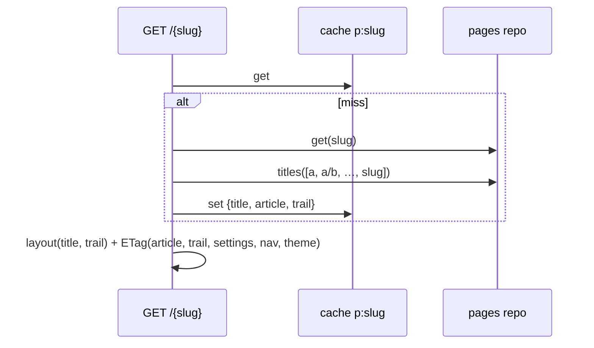

# Derive page titles and breadcrumb labels from the page's first H1

Issue: #17

## Goal

A page's title is the text of its **first H1** (`# …`, outside code fences). A page with no H1 falls back to the humanized slug (`slugDisplayName`, today's behavior). The title is the single name of a page everywhere: the stored `pages.title` column (which feeds the All-pages list and search results), the reader's tab title and breadcrumb, and the editor's tab title and breadcrumb. In nested pages, every ancestor crumb shows that ancestor's title by the same rule, and a missing ancestor shows its slug-derived label. In the editor, the breadcrumb and tab title follow the H1 live as it is typed.

## Non-goals

- Stripping inline markdown from titles. `# The **Old** Gods` titles as `The **Old** Gods`, the same raw heading text `extractTitle` stores today.
- The Home crumb label: it stays the site name, else "Home".
- Status pages (404/403 documents) and admin trails, which keep their fixed titles.
- The CodeMirror 6 spike (`?cm6=1`). It keeps slug-derived crumbs through `renderBreadcrumb`'s default label.
- Cross-session freshness of **other** pages' titles inside an open editor. If another editor retitles an ancestor, this session sees it on the next reload. The page being edited is always live.
- Renaming slugs to match H1s.

## Context

- **Title today:** `src/server/render/title.ts`.
  - `extractTitle(markdown, fallback)` takes the first **h1–h3**. It tokenizes line by line with no block pass, so `# x` inside a fence counts.
  - Callers in `src/server/routes/pages-api.ts`:
    - POST: explicit body `title`, else `extractTitle(content, slugDisplayName(slug))`.
    - PUT: explicit body `title`, else `extractTitle(content, existing.title)`. A page that loses its heading keeps its old title.
    - `moveRewriter`: `extractTitle(content, row.title)`, only when content changed.
  - `docs/api.md` documents the `title?` body field. The client never sends it (`src/client/api-page-store.ts`).
- **Engine:** `buildDocument(text, plugins)` in `src/core/document.ts` (DOM-free) returns `DocModel { lines: Token[][], blocks }`.
  - Fence lines become one `text` token, so a fenced `# x` is never an `h1` token.
  - Headings: `src/core/plugins/headings.ts` (`h1` = `/^# (.*)$/`).
  - `defaultPlugins`: `src/core/plugins/defaults.ts`.
  - `editor-render.ts` `render()` already calls `buildDocument(raw, contentPlugins)` on every repaint.
- **Slug label:** `slugDisplayName(slug)` in `src/shared/slug.ts` (last segment, words capitalized).
- **Reader:** `src/server/routes/pages-html.ts`.
  - `trailFor(slug)` labels every crumb `slugDisplayName(segment)`.
  - `renderArticle` caches `p:<slug>` → `{title, article}`. The trail is rebuilt per request.
  - ETag = hash(article + settings revision + nav links + theme CSS). The trail is not part of it.
  - The 404 path uses `trailFor` too.
  - Layout: `renderCrumbs` in `src/server/render/layout.ts` (label `href === '/'` → home label).
- **Cache invalidation:** `src/server/app.ts` `invalidate(slug, change)`.
  - `change !== 'updated'` → `cache.clear()`. Otherwise only `p:<slug>`, the index, status keys and the nav-links service are evicted.
  - `PageWriteChange = 'created' | 'updated' | 'deleted' | 'moved'` (pages-api.ts).
- **Move:** `src/server/db/page-move.ts` `computeRowUpdates` keeps `row.title` unless the rewrite changed content. The pg and memory repositories both use it.
- **Repository:** `src/server/db/repository.ts` (`PagesRepository`), `pages-pg.ts`, `pages-memory.ts`. `existing(slugs)` is the batched-lookup precedent.
- **Migrations:** `src/server/db/migrate.ts`.
  - Runs `^\d+.*\.sql$` files under a session advisory lock (`LOCK_KEY 7266796`) and records them in `schema_migrations(name)`.
  - Called from `src/server/index.ts` before the repositories are built.
- **Editor shell:** `src/server/render/editor-shell.ts`.
  - `<title>` = `composeDocTitle(slugDisplayName(slug), siteName)`.
  - The page embed carries `content`, `version` and `linkExists` (read by `client/main.ts` `readPageEmbed`).
- **Editor core:**
  - Trail = `[homeSlug, ...segments]` of the current page (`editor-state.ts`, `applyTrailNavigation`). Crumb `i ≥ 1` addresses `trail.slice(1, i+1).join('/')`.
  - `breadcrumb.ts` `renderBreadcrumb(…, trail, {homeLabel, onCrumb, onEditActive})` labels crumbs `slugDisplayName(segment)`. It is shared with the CM6 spike.
  - `editor-render.ts` `renderBreadcrumb()` repaints and calls `onTrailChange`.
  - `PageExistenceResolver {exists, request, onChange}` (`types.ts`) is the pattern for a server-backed lookup the core asks synchronously.
  - New pages are seeded `# ${slugDisplayName(page)}` (`editor-navigation.ts` `seedContentFor`), so a seed's title equals its fallback.
- **Client:** `src/client/main.ts` sets `document.title = composeDocTitle(slugDisplayName(…))` in `onSaved`, `onTrailChange` (page change) and `onPageMoved`. `src/client/link-existence.ts` is the fetch-backed resolver precedent.
- **Tests:** Vitest `dom` (core/client) and `node` (server/shared), co-located in `__tests__/`. Relevant suites: `pages-api`, `pages-html`, `page-move`/`pages-memory`, `pages-pg.integration` (`WN_TEST_PG_URL`), `editor-shell`, `breadcrumb`/`editor-render`, `link-existence`, `node-smoke`.

## Decisions

| # | Decision | Alternative considered | Reason |
| - | -------- | ---------------------- | ------ |
| 1 | **Only H1** counts as the title source. | Keep h1–h3 (current stored-title rule). | User decision; it matches the issue. All-pages and search titles change for pages whose first heading is h2/h3. |
| 2 | Title is a pure function `pageTitle(content, slug)`: the first non-empty H1 found through the **block pass** (fenced `# x` is not a title), else `slugDisplayName(slug)`. | Line-by-line tokenizing (today) or the previous stored title as the fallback. | Same structure the renderer sees. Removing the H1 reverts the title to the slug-derived one, as the issue requires. |
| 3 | `pageTitle` lives in **`src/core/page-title.ts`** (DOM-free); `src/server/render/title.ts` is deleted. | Keep it server-only. | The editor must compute the live title from its buffer with the same rule (single-renderer spirit). Server may import DOM-free core. |
| 4 | **Remove the explicit `title` field** from POST/PUT bodies. It is ignored, and `MAX_TITLE_LENGTH` and its 400 go away. | Keep it as an override. | User decision: the title is always derived, so the stored column can never disagree with the H1 rule. The client never sends it. |
| 5 | The stored `pages.title` column stays the source for lists, search and reader titles. It is written as `pageTitle(content, slug)` on create, update, and **every row a move touches** (a moved page without an H1 gets its new slug's label). | Compute titles at read time from content. | Lists and search already read the column. Read-time derivation would fetch content for every listed page and ancestor. |
| 6 | **One-time backfill at boot**: recompute every stored title, recorded as `schema_migrations` row `titles-from-first-h1`. It runs inside a transaction holding `pg_advisory_xact_lock(7266796)`, re-checks the marker after taking the lock, and updates only rows whose title differs. It never bumps `version` or `updated_at`. | Every-boot reconcile; no backfill. | User decision. The name never matches the runner's `^\d+.*\.sql$` filter, so the SQL runner ignores it. |
| 7 | Repository gains `titles(slugs): Promise<Map<string, string>>` (exact page slugs only, no aliases, one round trip, empty input skips the store). | Reuse `existing()`. | Existence and titles answer different questions; aliases have no title. |
| 8 | **Reader trail:** every ancestor crumb and the current crumb label = stored title, else `slugDisplayName(that ancestor's full slug)`. The labels are computed on cache miss with one `titles()` call and stored in the `p:<slug>` cache value next to `title` and `article`. The 404 trail uses the same helper (uncached). | Query titles on every request. | Cache hits stay DB-free, matching the cache's purpose. |
| 9 | **Invalidation:** a PUT whose stored title changes reports a new `PageWriteChange` `'retitled'`. The existing `change !== 'updated'` rule then clears the whole cache, because descendants' cached trails embed the title. | Prefix-invalidate descendants. | Same trade the code already makes for create/delete: retitles are rare; a full clear is simpler than a reverse index. |
| 10 | Reader **ETag mixes in the trail labels**. | Leave the ETag alone. | Otherwise a browser revalidating a child page after an ancestor retitle gets a 304 with a stale breadcrumb. |
| 11 | New endpoint **`GET /api/page-titles?slugs=a,a/b`** → `{ titles: { [slug]: string } }` for the slugs that exist. Same read gate, validation (invalid slugs omitted), 100-slug cap and cache headers as `/api/pages-exist`. It lives outside `/api/pages/*` for the same wildcard reason. | Extend `/api/pages-exist`, or put ancestors in `GET /api/pages/{slug}`. | Keeps one question per endpoint, and buffered pages skip the page GET. |
| 12 | **Editor shell** `<title>` uses the stored title (missing page: `slugDisplayName`, which equals the seed's H1). The page embed gains `titles` (stored titles of the current page's existing ancestors) to seed the client resolver. | Fetch after first paint. | No first-paint flash of slug labels. |
| 13 | **Editor crumb label** for crumb `i ≥ 1` (slug = joined trail prefix), first match wins: (a) the page buffer, if loaded or seeded → `pageTitle(buffer, slug)`, which is live; (b) `options.pageTitles.title(slug)`, the server answer; (c) `slugDisplayName(slug)`. Root crumb unchanged. | Server titles only. | Visited pages and the current page are always fresh; unvisited ancestors come from the server. |
| 14 | Core option **`pageTitles?: PageTitleResolver`** `{ title(slug): string \| undefined; request(slugs): void; onChange(listener): () => void }`, mirroring `PageExistenceResolver`. `renderBreadcrumb()` requests the labels it lacks, and `onChange` repaints the breadcrumb. The client resolver (`src/client/page-titles.ts`) is seeded from the embed, fetches only slugs it has never asked about, keeps answers for the session, and fails silently (the label stays slug-derived). | Copy link-existence's staleness/batching machinery. | Requests are trail-sized (a handful of slugs); session-long answers are the accepted non-goal above. |
| 15 | **Live update:** `editor-render.ts` `render()` derives the current page's title from the `DocModel` it already builds. When the title differs from the last painted one, it repaints the breadcrumb. New core option **`onTitleChange?(title)`** fires whenever the current page's title changes, including after navigation and moves. `main.ts` sets `document.title` only from it; the three `slugDisplayName` `document.title` writes are removed. | Update on save/navigation only. | User decision. Reusing the render's model adds no extra parse per keystroke. |
| 16 | `renderBreadcrumb` (breadcrumb.ts) gains an optional `label?(index): string`; its default is today's `slugDisplayName(trail[i])`. | Required parameter. | The CM6 spike (non-goal) keeps working unchanged. |

## Design

### Title rule (core)

```ts
// src/core/page-title.ts
export function titleFromDoc(doc: DocModel): string | null  // first line whose tokens are exactly [h1] with non-empty trimmed text
export function pageTitle(content: string, slug: string, plugins: ContentPlugin[] = defaultPlugins): string
  // titleFromDoc(buildDocument(content, plugins)) ?? slugDisplayName(slug)
```

### Server write path

- POST `/api/pages`: `title = pageTitle(content, slug)`.
- PUT `/api/pages/*`:
  1. Reads `existing` (this already happens; a missing page → `missingOrMoved`).
  2. `title = pageTitle(content, slug)`.
  3. After `putIfMatch` succeeds: `onWrite(slug, existing.title !== title ? 'retitled' : 'updated')`.
- The body's `title` is no longer read.
- Move: `MoveInput` gains `title(slug: string, content: string): string`. `computeRowUpdates` sets `title = input.title(newSlug, finalContent)` for every update row; rows are still selected only when their slug or content changes. `moveRewriter` returns `{ content }` only. `RowUpdate.title` is still written by both repositories.

### Backfill

`src/server/db/title-backfill.ts` exports `backfillTitles(pool, compute = pageTitle): Promise<number>`. It is called in `index.ts` right after `runMigrations` and logs the count when non-zero. It runs in one transaction:

```sql
BEGIN;
SELECT pg_advisory_xact_lock(7266796);
-- marker present → COMMIT; return 0
SELECT slug, title, content FROM pages;
UPDATE pages SET title = $2 WHERE slug = $1;   -- per changed row
INSERT INTO schema_migrations (name) VALUES ('titles-from-first-h1');
COMMIT;
```

### Reader



`trailFor(slug)` becomes `async trailFor(slug)`. It returns `[{href:'/',label:'Home'}, …ancestors…]` with `label = titles.get(ancestorSlug) ?? slugDisplayName(ancestorSlug)`. The home page keeps `[Home]`.

### Editor

- **Shell:** `editorShellHtml` gets `title: string` and `titles: Record<string,string>`. `pages-html.ts` computes both with one `titles()` call over the ancestor chain.
- **`types.ts`:** adds `PageTitleResolver` and the `EditorOptions` fields `pageTitles?` and `onTitleChange?`.
- **`editor-render.ts`:**
  - Keeps `lastTitle`.
  - `render()` → `titleFromDoc(doc) ?? slugDisplayName(page)`. When it changed: repaint the breadcrumb and call `onTitleChange`.
  - `renderBreadcrumb()` passes `label(i)` per Decision 13, requests the unknown labels, and fires `onTitleChange` when the current title differs from `lastTitle`. Navigation and moves already repaint through it.
- **`editor.ts`:** subscribes `pageTitles.onChange` → `render.renderBreadcrumb()`.
- **Client:**
  - `createPageTitles(seed, deps)` in `src/client/page-titles.ts`: one fetch per `request()` batch, chunked to 100 slugs.
  - `main.ts` passes it as `pageTitles`; `onTitleChange` sets `document.title = composeDocTitle(title, cfg.siteName)`.

## Testing

Unit and integration tests run with Vitest (`npm test`); the pg integration suite runs with `WN_TEST_PG_URL`.

- `src/core/__tests__/page-title.test.ts`:
  - first H1 wins over an earlier h2;
  - `# x` inside a fence is ignored;
  - an empty `# ` is skipped;
  - no H1 → `slugDisplayName` of a nested slug;
  - the text is trimmed.
- `pages-api`:
  - POST/PUT store the H1 title;
  - a body `title` is ignored;
  - removing the H1 reverts to the slug label;
  - `onWrite` reports `'retitled'` only when the title changed;
  - a move retitles a moved page that has no H1;
  - `/api/page-titles` returns existing slugs only, omits invalid ones, and answers 400 above the cap.
- `page-move` / `pages-memory`: the title is recomputed for moved rows whose content did not change.
- `pages-pg.integration`:
  - `titles()`;
  - `backfillTitles` updates stale titles once, writes the marker, and a second run is a no-op that leaves `version` untouched.
- `pages-html`:
  - nested reader breadcrumb uses the ancestor H1 titles, with the slug label for a missing ancestor;
  - a cache-hit page shows a parent's new title after the parent is retitled through the API (clear + ETag change);
  - the 404 trail uses ancestor titles;
  - the editor shell `<title>` and the embedded `titles` are present.
- Core `breadcrumb` / `editor-render`:
  - crumb labels come from the buffer, then the resolver, then the slug;
  - typing a new H1 repaints the active crumb and fires `onTitleChange`;
  - a resolver `onChange` repaints.
- Client `page-titles`:
  - seeded answers need no fetch;
  - unknown slugs are fetched once;
  - a failure leaves them undefined without refetch loops.

**Manual (dev server `npm run dev`):**

1. Sign in as an editor. Create `lore` containing `# Lore of Ashfall` and `lore/old-gods` containing `# The Old Gods`.
2. Open `/lore/old-gods` in a private window (anonymous reader). Expect the breadcrumb "Home / Lore of Ashfall / The Old Gods" and the tab "The Old Gods — <site>".
3. In the editor on `/lore/old-gods`: expect the same breadcrumb. Change the H1 to `# Older Gods`; the active crumb and the tab title update while typing.
4. Edit `lore` and delete its H1 line. Reload `/lore/old-gods` (reader and editor); the parent crumb reads "Lore".
5. `/all` lists the pages by their H1 titles.

## Steps

- [ ] 1. Core title rule + server write path: add `src/core/page-title.ts` (+ tests); POST/PUT/move derive titles with `pageTitle` (explicit `title` body dropped, `MoveInput.title` + `computeRowUpdates` retitle moved rows); delete `src/server/render/title.ts`; update pages-api/page-move tests; `docs/api.md` body fields.
- [ ] 2. Repository `titles(slugs)` (pg + memory + tests) and the one-time `backfillTitles` boot step wired in `index.ts` (+ pg integration test); `docs/architecture.md` migration note.
- [ ] 3. Reader breadcrumb from titles: async `trailFor` with `titles()`, trail stored in the page cache value, ETag mixes trail, `'retitled'` write change from PUT; pages-html/pages-api tests.
- [ ] 4. `GET /api/page-titles` endpoint + editor shell `<title>` from the stored title and embedded ancestor `titles`; tests; `docs/api.md`.
- [ ] 5. Editor core: `PageTitleResolver` + `pageTitles`/`onTitleChange` options, breadcrumb `label` option, crumb labels per Decision 13, live repaint on H1 change; core tests.
- [ ] 6. Client: `src/client/page-titles.ts` resolver (+ tests), `main.ts` wiring (`pageTitles`, `document.title` from `onTitleChange`, slug-based writes removed); `docs/architecture.md` request-flow note.

## Risks & open questions

- *Accepted:* All-pages/search titles change for pages whose first heading is h2/h3 (Decision 1).
- *Accepted:* An open editor session does not see other editors' retitles of pages it has not loaded until reload (Non-goals).
- *Accepted:* Every retitle clears the whole render cache (Decision 9).

## Implementation notes

## Review
